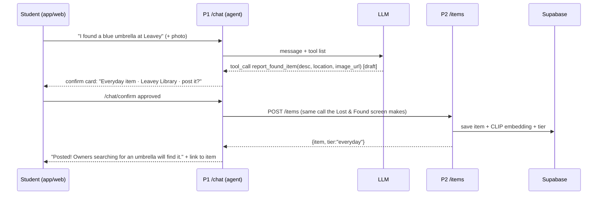
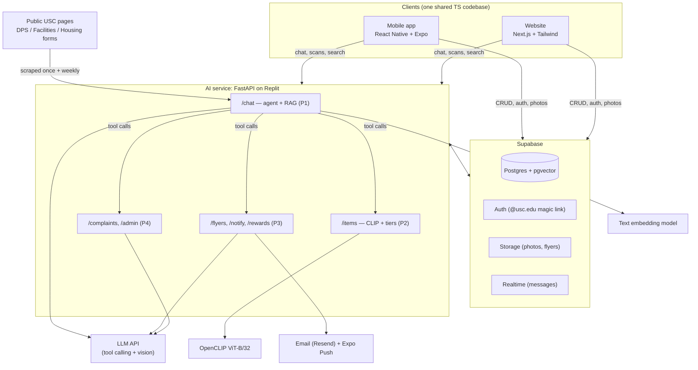

# TrojanHub — Architecture & Implementation Plan

> AI@USC Hackathon · Sat Nov 14 – Sun Nov 15, 2026 · Submission due **Sun 11:00 AM PT**
> One AI campus companion: **mobile app + website**, one backend, one AI service.

---

## 1. Team and ownership

| # | Person | Owns (feature area) | Main folders |
|---|---|---|---|
| P1 | **Naman** | **Tommy, the chatbot**: scraping USC pages, RAG, agent with tool calling, chat UI (app + web) | `services/ai/app/chat/`, `services/ai/app/rag/`, `services/ai/scripts/scrape/`, `apps/*/…/chat/` |
| P2 | **Vishwa** | **Lost & Found**: CLIP service, tier sorting, search, claim + in-app messages, drop-off points | `services/ai/app/lostfound/`, `apps/*/…/lost-found/` |
| P3 | **Parnavi** | **Events, Deals & Freebies**: flyer scanner, calendar, RSVP / register, attendance rewards, notifications (daily digest + reminders), personalized feed | `services/ai/app/events/`, `services/ai/app/notify/`, `apps/*/…/events/`, `apps/*/…/deals/`, `apps/*/…/home/` |
| P4 | **Jaymin** | **Platform + Complaints + Admin**: repo and app shells, Supabase schema and auth, complaint sorter and duplicate grouping, admin dashboard, deployment, design system | `supabase/`, `packages/shared/`, `apps/*` shells and nav, `services/ai/app/complaints/`, `services/ai/app/admin/`, `apps/web/app/admin/` |

**Everyone** works on the final demo, video, slides, and Devpost write-up in Phase 4.

Each person builds their feature **end to end**: backend endpoint, database tables (proposed to
P4), mobile screen, and web page. P4 provides the empty app shells, design system, auth, and DB
so everyone else can plug in.

### 1.1 Chat is the front door; each feature is a room

Tommy is **not** where the features live. It's one more way in. Each feature has two doors:

| Feature | Door 1: its own screens | Door 2: Tommy chat | Who builds the engine |
|---|---|---|---|
| Lost & Found | Report / search / claim screens | "I found a blue umbrella at Leavey", "anyone find a black Hydro Flask?" | **Vishwa (P2)** (CLIP, tiers, storage, messages) |
| Events / Deals / Freebies | Calendar, deals page, rewards page, feed | "any free food today?", photo of a flyer | **Parnavi (P3)** (flyer reader, search, calendar, notifications) |
| Complaints | Report-a-problem form | "it's so hot in GFS 213" | **Jaymin (P4)** (classifier, routing, dedupe) |
| Campus info | — | "when is the food pantry open?" | **Naman (P1)** (RAG over USC pages) |

- **P1 (Naman) owns:** understanding what the user wants, choosing the right tool, the confirm
  cards, answers from USC pages, and the chat screens.
- **Vishwa / Parnavi / Jaymin own:** the endpoint that does the work and the screens for it. Tommy calls *their*
  endpoint, the same one their screen calls, so an item reported from chat and one reported from
  the screen are identical.
- If Tommy needs something an endpoint doesn't offer (e.g. "search by building"), P1 asks the owner
  to add a parameter. **P1 never writes to another feature's tables directly.**

### 1.2 How the integration works (one request, end to end)

Example: *"I found a blue umbrella at Leavey"* in chat.



**What makes this work in 24 hours:**
1. **Contracts first (Phase 0).** Every endpoint's request and response types live in
   `packages/shared/types.ts`, with a mock JSON in `packages/shared/mocks/`.
2. **P1 builds against mocks.** Until P2's real `/items` is up, Tommy's tool wrapper reads the
   mock. Switching is one env flag: `USE_MOCKS=false`, or per feature with
   `REAL_FEATURES=complaints,admin` while the rest stay mocked.
3. **One wrapper per tool** in `services/ai/app/chat/tools/<feature>.py`. Each one only calls
   HTTP and maps fields, with no feature logic. If an owner changes their endpoint, only that file
   changes.
4. **Integration checkpoints** at 7 PM and 11 PM: P1 runs each demo prompt against the real
   endpoints with the owner sitting next to them.

---

## 2. System overview



**The main idea:** simple reads and writes (events list, deals list, profile) go straight from
the clients to Supabase. Anything that uses AI goes through the FastAPI service. The chatbot
doesn't write to tables directly. It calls the same endpoints that P2, P3, and P4 build. That way
each feature works the same whether it's used from a screen or from chat.

---

## 3. Tech stack

| Layer | Choice | Notes |
|---|---|---|
| Mobile | React Native + **Expo** (expo-router, expo-camera / image-picker, expo-notifications) | Run with Expo Go for the demo |
| Web | **Next.js 14+** (App Router) + **Tailwind** + shadcn/ui | Cardinal `#990000`, gold `#FFCC00` |
| Shared | `packages/shared`: TS types, zod schemas, typed API client | Mobile and web both import this |
| DB / Auth / Storage | **Supabase**: Postgres + `pgvector`, Auth, Storage, Realtime | Row-level security (RLS) on |
| AI service | **FastAPI** (Python 3.11) on **Replit** | Qualifies for Best Use of Replit |
| LLM | One hosted model with **tool calling + vision**, called through an OpenAI-compatible client (`base_url` + key from env) | One wrapper in `services/ai/app/core/llm.py`, so switching providers needs no code changes. See §13 |
| Text embeddings | `sentence-transformers/all-MiniLM-L6-v2` (384-d, free, CPU) *or* a hosted embedding API | Decide in Phase 0; pick ONE dimension |
| Image embeddings | `open_clip` **ViT-B-32** (`laion2b_s34b_b79k`), 512-d | Same model encodes image and text |
| Scraping | `httpx` + `selectolax`/BeautifulSoup; `trafilatura` for main text | Public pages only |
| Email | **Resend** (free tier) | Daily freebie digest |
| Push | **Expo Push API** | Matches, reminders |
| Maps | `react-native-maps` / Mapbox GL JS + `buildings` seed table | Drop-offs, complaint map |

---

## 4. Repository layout

```
trojanhub/
├── CLAUDE.md
├── ARCHITECTURE.md
├── .env.example
├── apps/
│   ├── mobile/                      # Expo (P4 shell; features by owner)
│   │   └── app/
│   │       ├── (tabs)/home.tsx          # P3  personalized feed
│   │       ├── (tabs)/chat.tsx          # P1  Tommy
│   │       ├── (tabs)/lost-found/…      # P2
│   │       ├── (tabs)/events/…          # P3  events + deals + rewards
│   │       ├── (tabs)/report.tsx        # P4  complaint form
│   │       └── auth/…                   # P4
│   └── web/                         # Next.js (P4 shell; features by owner)
│       └── app/
│           ├── page.tsx                 # P3  feed
│           ├── chat/                    # P1
│           ├── lost-found/              # P2
│           ├── events/  deals/  rewards/# P3
│           ├── report/                  # P4
│           └── admin/                   # P4  dashboards
├── packages/
│   └── shared/                      # P4 owns; changes by PR + ping
│       ├── types.ts                     # DB row types + API types
│       ├── api.ts                       # typed fetch client for services/ai
│       └── theme.ts                     # colors, spacing, fonts
├── services/
│   └── ai/                          # FastAPI
│       ├── app/
│       │   ├── main.py                  # P4  app + router mounting + CORS
│       │   ├── core/                    # P4  config, supabase client, llm.py, auth check
│       │   ├── chat/                    # P1  agent loop, tools, prompts
│       │   ├── rag/                     # P1  retrieve, rerank, cite
│       │   ├── lostfound/               # P2  clip.py, tiers.py, routes.py
│       │   ├── events/                  # P3  flyer.py, dedupe.py, rewards.py, routes.py
│       │   ├── notify/                  # P3  digest.py, reminders.py, push.py, email.py
│       │   ├── complaints/              # P4  classify.py, dedupe.py, routing.py, routes.py
│       │   └── admin/                   # P4  stats.py, routes.py
│       ├── scripts/
│       │   ├── scrape/                  # P1  crawl + chunk + embed USC pages
│       │   └── seed.py                  # P4  demo seed data (everyone adds rows)
│       ├── evals/chat_questions.jsonl   # P1  20–30 test questions
│       └── requirements.txt
└── supabase/
    ├── migrations/                  # P4 owns; others propose tables via PR
    └── seed.sql
```

---

## 5. Database schema (Supabase / Postgres)

`create extension if not exists vector;` · Every table has `id uuid default gen_random_uuid()`
and `created_at timestamptz default now()` unless noted.

### Core (P4)
| Table | Key columns |
|---|---|
| `profiles` | `id` (= auth.users.id), `name`, `role` (`student`/`org_admin`/`dept_admin`/`usg_admin`), `interests text[]`, `notify_email bool`, `notify_push bool`, `notify_categories text[]`, `expo_push_token` |
| `orgs` | `name`, `verified bool`, `owner_id → profiles` |
| `buildings` | `code` (e.g. `GFS`), `name`, `lat`, `lng` |

### Chatbot (P1)
| Table | Key columns |
|---|---|
| `doc_chunks` | `url`, `title`, `section`, `content`, `contacts jsonb` (emails/phones found on that page), `embedding vector(<D>)`, `scraped_at` |
| `chat_messages` | `user_id`, `session_id`, `role`, `content`, `tool_calls jsonb`, `sources jsonb` |

### Lost & Found (P2)
| Table | Key columns |
|---|---|
| `items` | `kind` (`found`/`lost`), `tier` (`valuable`/`everyday`), `title`, `description`, `photo_url`, `img_embedding vector(512)`, `text_embedding vector(512)`, `building_id`, `location_text`, `dropoff_point_id`, `status` (`open`/`claimed`/`archived`), `posted_by`, `expires_at` |
| `dropoff_points` | `name`, `type` (`dps`/`it`), `building_id`, `hours`, `url` |
| `item_threads` | `item_id`, `owner_id`, `finder_id`, `status` |
| `messages` | `thread_id`, `sender_id`, `body` (Realtime on) |

### Events, Deals & Freebies (P3)
| Table | Key columns |
|---|---|
| `events` | `title`, `description`, `starts_at`, `ends_at`, `building_id`, `location_text`, `category`, `is_free`, `has_freebie bool`, `freebie_desc`, `register_url`, `ticket_url`, `tickets_open_at`, `org_id`, `posted_by`, `source` (`org`/`community`/`flyer`), `flyer_url`, `status` |
| `deals` | `title`, `description`, `kind` (`ongoing`/`one_time`), `how_to_claim`, `link`, `starts_at`, `expires_at`, `posted_by`, `still_active_votes int` |
| `event_saves` | `user_id`, `event_id`, `registered bool`, `reminder_sent_at` |
| `reward_programs` | `name`, `office` (e.g. Viterbi Career Center), `reward_desc`, `required_count`, `rules_url` |
| `reward_program_events` | `program_id`, `event_id` |
| `attendance` | `user_id`, `event_id`, `checked_in_at` (demo: self check-in / QR) |
| `notification_log` | `user_id`, `type` (`digest`/`reminder`/`match`), `ref_id`, `sent_at` |

### Complaints (P4)
| Table | Key columns |
|---|---|
| `tickets` | `building_id`, `room`, `department`, `category`, `urgency` (`low`/`medium`/`high`/`safety`), `summary`, `status` (`reported`/`sent`/`resolved`), `report_count`, `route_url`, `embedding vector(<D>)` |
| `complaints` | `ticket_id`, `reporter_id` (nullable = anonymous), `raw_text`, `room`, `building_id`, `photo_path` (in the private `complaint-photos` bucket) |
| `routes` | `department`, `category`, `form_url`, `email` (seeded from public USC pages) |

**RLS basics:** anyone logged in can read public rows. Users can only edit their own rows. Only org admins can post events as verified. `dept_admin`/`usg_admin` can read admin views. The AI service uses the **service role key**, which only ever lives on the server.

---

## 6. API contracts (FastAPI, base `/api`)

All endpoints take the Supabase JWT in `Authorization: Bearer <token>`. `core/auth.py` (P4) checks
it and passes `user_id` to the endpoint. JSON uses snake_case. **Every owner commits a mock
response in `packages/shared/mocks/` in Phase 0**, so the others can build against it before the
real endpoint exists.

### P1 — Chat
| Method | Path | Body → Response |
|---|---|---|
| POST | `/chat` | `{session_id, message, image_url?}` → **SSE stream** of `{type:"token"|"tool_call"|"tool_result"|"sources"|"confirm"|"done", …}` |
| POST | `/chat/confirm` | `{session_id, action_id, approved: bool, edits?}` → runs the action that was waiting for a yes |

### P2 — Lost & Found
| Method | Path | Body → Response |
|---|---|---|
| POST | `/items` | multipart `{photo, kind, description?, building_id?, location_text?}` → `{item, tier, dropoff?: {name, url, map}}` |
| GET | `/items/search` | `?q=black hydro flask&building_id=` → `{results:[{item, score}]}` (top 10) |
| POST | `/items/search-by-image` | multipart `{photo}` → same as above |
| POST | `/items/describe` | multipart `{photo}` → `{title, description, source: "ai"\|"label"\|"none"}` (pre-fills "What is it?"; the finder can edit it) |
| POST | `/items/{id}/claim` | `{}` → `{thread_id}` (everyday only; valuables return the DPS/IT pickup info instead) |

### P3 — Events, Deals, Freebies, Notifications
| Method | Path | Body → Response |
|---|---|---|
| POST | `/flyers/scan` | `{image_url}` → `{type:"event"|"deal", fields:{title, starts_at, ends_at, location_text, building_id?, is_free, has_freebie, freebie_desc, register_url, org_name, category}, missing:[…], duplicate_of?: id}` |
| GET | `/events/search` | `?q=&from=&to=&category=&free=&freebie=` → `{events:[…]}` (simple SQL + optional semantic) |
| GET | `/deals/search` | `?q=&active=true` → `{deals:[…]}` |
| PATCH | `/events/{id}` | any `POST /events` fields (no `flyer_url`/`force`) → `{event}`. Poster, org owner or admin only (403); `GET /events/{id}` returns `can_edit` |
| DELETE | `/events/{id}` | → `{deleted:true}` (status → `cancelled`, hidden everywhere). Same people as PATCH |
| POST | `/events/{id}/save` | `{register?: bool}` → `{saved:true, ics_url, register_url?}` |
| GET | `/events/{id}/ics` | → `.ics` file (Google/Apple calendar) |
| GET | `/rewards/progress` | → `[{program, attended, required, next_eligible_events:[…]}]` |
| POST | `/notify/daily-digest` | (cron, secret header) → sends today's freebies to opted-in users |
| POST | `/notify/reminders` | (cron every 10 min) → reminders 30 min before saved events |
| GET | `/feed` | → `{for_you:[3 items], today_freebies:[…]}` |

### P4 — Complaints & Admin
| Method | Path | Body → Response |
|---|---|---|
| POST | `/complaints` | `{text, building_id?, building?, room?, anonymous?: bool, confirm?: bool, photo?}` (`building` = code or name, for when it isn't in `text`; `building_id` wins). Optional `photo` (data: URL): checked on every call, stored privately only on `confirm:true` → `{draft:{department, category, urgency, building, room, summary}, duplicate_ticket?: {id, report_count}, safety?: {dps_phone, message}}`. With `confirm:true` → `{ticket, route_url}` |
| GET | `/complaints/mine` | → user's complaints + ticket status |
| POST | `/tickets/{id}/upvote` | → `{report_count}` |
| GET | `/admin/complaints` | `?department=&building=&from=` → `[{logged_at, text, building, room, source, ai_department, ai_confidence, ai_reason, corrected_department, forwarded_to, forwarded_at, status, report_count, photo_url}]` (`photo_url` = signed link, ~1 hour) |
| PATCH | `/admin/complaints/{id}` | `{corrected_department?, status?}` → updated row |
| GET | `/admin/stats` | → `{total, forwarded_pct, routing_accuracy_pct, by_department:[…], by_building:[…]}` |
| GET | `/admin/tickets.csv` | → CSV export |

---

## 7. Feature internals

### 7.1 Tommy the chatbot (P1, Naman)

**Scrape → index (Phase 0–1)**
1. `scripts/scrape/seeds.yaml`: a hand-picked list of about 40–80 public USC URLs (food pantry,
   basic needs, DPS, Facilities, Housing, ITS, libraries, Engemann health, career centers,
   transportation, dining). Hand-picking gives better quality than crawling everything.
2. `crawl.py`: fetch (be polite: 1 request/sec, follow robots.txt), extract the main text with
   `trafilatura`, keep `title`, `url`, and headings.
3. `extract_contacts.py`: use a regex to pull emails, phone numbers, and hours from each page into
   `contacts jsonb`. **The bot quotes contact details only from here and never generates them.**
4. `chunk.py`: about 180–220 tokens per chunk with 40 tokens of overlap, cut at heading
   boundaries, and each chunk starts with the page title and section. (Not 500: MiniLM only
   reads the first 256 tokens, so anything past that in a chunk is invisible to search.)
5. `embed.py`: embed each chunk and upsert it into `doc_chunks`. Rerun the script to refresh.

**Retrieve (`rag/retrieve.py`)**
- Expand campus acronyms (IT, DPS…) → embed the query → pgvector cosine top-k=40 → re-rank with
  keyword and title overlap, plus a boost when the question asks for hours or a contact and the
  page has one → keep results with score ≥ threshold (0.40, tuned on the eval set).
- If the best page is small (≤ 5 chunks), return the whole page plus up to 2 chunks from other
  pages, so the answer doesn't depend on which section matched. Otherwise keep the top 4
  (max 2 per page).
- If nothing passes the threshold → return `no_answer`. The bot then says "I couldn't find
  that" and links the closest page.

**Agent loop (`chat/agent.py`)**
- System prompt: "You are Tommy… answer ONLY from the provided sources and cite them with [n].
  Never invent emails or phone numbers. Before any action that writes data, call the tool in
  `draft` mode and ask the user to confirm."
- Loop: LLM → if it makes a tool call → run the tool → feed the result back → repeat (max 4
  steps) → stream the final answer + `sources` event.
- **Tools** (each one is a thin wrapper around another owner's endpoint):

| Tool | Calls | Writes? |
|---|---|---|
| `search_usc_info(query)` | `rag.retrieve` | no |
| `search_lost_items(query, building?)` | P2 `GET /items/search` | no |
| `report_found_item(description, location, image_url?)` | P2 `POST /items` | **confirm** |
| `search_events(query, date_range?, free_only?, freebie_only?)` | P3 `GET /events/search` | no |
| `search_deals(query)` | P3 `GET /deals/search` | no |
| `scan_flyer(image_url)` | P3 `POST /flyers/scan` | **confirm** before saving |
| `save_event(event_id, register?)` | P3 `POST /events/{id}/save` | **confirm** |
| `log_complaint(text, building?, room?)` | P4 `POST /complaints` | **confirm** (draft → user OK → confirm:true) |

- **Confirm flow:** a write tool returns a `confirm` SSE event that contains the draft. The UI
  shows a card with Edit / Confirm / Cancel buttons and calls `/chat/confirm`.
- **Intent example:** "it's so hot in GFS 213" → the LLM sees a complaint → calls `log_complaint`
  in draft mode → card: *Facilities · HVAC · medium · GFS 213 · "4 others reported this"* → Confirm.

**Chat UI (mobile + web)**
- Streaming bubbles, source chips (opens the URL), confirm cards, a camera button (upload to
  Storage → send `image_url`), and suggested prompts ("Free food today?", "Food pantry hours?",
  "I found something").

**Evals (`evals/chat_questions.jsonl`)**: 20–30 real questions with the expected URL. Run
`python -m evals.run` to check that the expected URL appears in the sources, and that contact
details match the source page exactly.

### 7.2 Lost & Found (P2)
- `clip.py`: load ViT-B-32 once at startup. `embed_image(bytes)` and `embed_text(str)` return
  L2-normalized 512-d vectors.
- `tiers.py`: zero-shot. Compare the image embedding with prompts like `"a photo of {label}"` for
  the labels VALUABLE = [airpods, earbuds case, phone, laptop, tablet, wallet, id card, keys, credit
  card, watch, glasses] and EVERYDAY = [water bottle, umbrella, jacket, hoodie, charger, notebook,
  textbook, hat, lunchbox, backpack*]. If the best label is valuable → `valuable`. If the margin is
  small → ask the finder ("Is this a valuable?"). *A backpack might contain valuables, so we ask.
- Search score = `0.7 * cos(text_query, img_embedding) + 0.3 * cos(text_query, text_embedding)`
  + a small bonus if the building matches. Return the top 10 and show the top 5.
- Valuables → response includes the nearest `dropoff_points` row (straight-line distance from the
  building).
- Messages: Supabase Realtime on `messages`. Never show email or phone numbers. Suggested meeting
  spots come from a constant list.
- Daily job: archive `everyday` items after 14 days.
- **Match alerts (stretch):** when a new found item scores high against an open `lost` post, send
  a push to the owner (use P3's `notify/push.py`).

### 7.3 Events, Deals & Freebies (P3)
- `flyer.py`: vision LLM with a strict JSON schema (the fields from §6). Dates are understood
  relative to today in America/Los_Angeles, and missing fields are returned in `missing`. The
  client shows an editable form before saving.
- `dedupe.py`: same date ±2h and title similarity > 0.85 (or embedding cosine) → `duplicate_of`.
- **Add to calendar:** `/events/{id}/ics` builds an `.ics` file; the web also offers a Google
  Calendar link (`calendar.google.com/calendar/render?action=TEMPLATE&…`).
- **Register:** if `register_url` is set, open it. Otherwise register inside TrojanHub (sets
  `event_saves.registered=true`).
- **Attendance rewards:** seed `reward_programs` for career-center style programs (exact rules
  come from each office's official page; link `rules_url`). Attendance for the demo = self
  check-in button or QR on the event page. Progress = count of attended events that count toward
  that program.
- **Notifications:**
  - `digest.py` (cron 8:00 AM PT): today's events with `has_freebie` plus one-time deals → users
    with `notify_email` / `notify_push`, filtered by `notify_categories`. **Skip if nothing is
    free today.** Write to `notification_log` so nobody gets the same message twice.
  - `reminders.py` (every 10 min): saved or registered events starting in 25–35 min → push +
    email.
  - Demo trigger: an admin-only "Send digest now" button.
- **Feed:** `for_you` = score events by matching interests, closeness in time, and having a
  freebie, then take the top 3.

### 7.4 Complaints & Admin (P4)
- `classify.py`: LLM → JSON `{department, category, urgency, building_code, room, summary,
  is_safety}`. Departments: Facilities, Housing, ITS, Transportation, DPS. If `is_safety` →
  return the DPS emergency info and **do not create a ticket**.
- `dedupe.py`: open tickets with the same building and room (or the same building if there is no
  room) and an embedding cosine > 0.8 within 7 days → add the complaint to the existing ticket and
  increase `report_count`.
- `routing.py`: `routes` table → `route_url`. Show a "Send to Facilities" button that opens their
  form or a `mailto:` link with the details filled in. **Never claim this is an official
  integration.**
- **Admin dashboard (web `/admin`): proof that routing works.** It answers three questions
  for every complaint:
  1. **Was it logged?** Time, building and room, the student's original words (anonymous if they
     chose that), and the source (chat or form).
  2. **Which department did the AI pick, and why?** Department + category + urgency, a
     **confidence score**, and a one-line reason from the classifier ("mentions heat + room →
     HVAC → Facilities").
  3. **Was it forwarded?** ✓ Sent to Facilities form / email at 2:14 PM, plus status
     (reported → sent → resolved) and duplicate count ("5 reports").
  - **Correct button:** an admin can change the department if the AI was wrong. That saves to
    `complaints.corrected_department`.
  - **Routing accuracy tile:** % of complaints where the admin did *not* correct the department.
    This is our live "the AI routes correctly" number for the judges. Seed 25 complaints and
    hand-check them so the number is honest.
  - Filters: department, building, urgency, date. CSV export.
  - Extra tables needed: `complaints` gets `ai_department`, `ai_confidence`, `ai_reason`,
    `corrected_department`, `forwarded_at`, `forwarded_to`, `source` (`chat`/`form`).
  - Org/USG views (events, RSVPs, verification) are **stretch**. Complaints routing is the
    must-have.

---

## 8. Shared conventions
- **Types first:** P4 generates `packages/shared/types.ts` from the schema (`supabase gen types`)
  at the end of Phase 0. API request and response types sit next to them.
- **Env vars** (`.env.example`): `SUPABASE_URL`, `SUPABASE_ANON_KEY`, `SUPABASE_SERVICE_ROLE_KEY`
  (AI service only), `LLM_BASE_URL`, `LLM_API_KEY`, `LLM_MODEL`, `USE_MOCKS`, `REAL_FEATURES`, `EMBED_MODEL`, `RESEND_API_KEY`,
  `CRON_SECRET`, `EXPO_PUBLIC_API_URL`, `NEXT_PUBLIC_API_URL`.
- **Dates:** stored as UTC `timestamptz`, shown in America/Los_Angeles.
- **Errors:** `{error: {code, message}}` with the matching HTTP status.
- **Design:** use components from `packages/shared/theme.ts` and the web `components/ui`. Cardinal
  only for primary actions. Targets: WCAG AA contrast, labeled buttons, 44px tap targets.

## 9. Git workflow
- Branches: `p1/chatbot`, `p2/lost-found`, `p3/events`, `p4/platform` (+ short-lived sub-branches).
- Merge into `main` through a PR. One quick review from anyone is enough. **Merge at least every
  3 hours** so nobody falls far behind `main`.
- Migrations: one file per change, named `YYYYMMDDHHMM_<owner>_<what>.sql`. Only P4 merges them.
- No Claude co-author or attribution lines in commits or PRs (see `CLAUDE.md`).

---

## 10. Implementation phases

Times are Pacific. "Done when" = the checkpoint everyone confirms at the sync.

### Phase 0: Setup and contracts · Sat 1:30 → 3:00 PM
| Person | Tasks |
|---|---|
| **P1 Naman** | Set up ChatGPT Edu → Codex shim and smoke-test chat, tools and images (§13.2). Get the backup API key. Write `seeds.yaml` (40–80 USC URLs). Start `crawl.py`. Write the mock SSE stream for `/chat`. Draft the system prompt and tool list. |
| **P2 Vishwa** | Install `open_clip` on Replit and check that it loads within memory limits. Mock `/items` + `/items/search`. Seed 6–10 `dropoff_points` (verify locations from official DPS/IT pages). |
| **P3 Parnavi** | Mock `/flyers/scan`, `/events/search`, `/feed`. Collect 5 real flyers (photos) for testing. Draft the `events`/`deals`/`reward_programs` tables. |
| **P4 Jaymin** | Create the monorepo, Supabase project, `vector` extension, core tables, auth (@usc.edu). Set up the Expo + Next.js shells with tab/nav placeholders, a FastAPI skeleton deployed on Replit, `.env.example`, and `types.ts`. |
**Done when:** everyone can run the app, the website, and the API locally. Mocks are in `packages/shared/mocks/`. The schema is merged.

### Phase 1: Core engines · Sat 3:00 → 7:00 PM
| Person | Tasks |
|---|---|
| **P1 Naman** | Finish scraping, chunking, contact extraction, and embedding into `doc_chunks`. Build `retrieve.py`. Get the `/chat` agent loop with `search_usc_info` answering with citations. Write the first 15 eval questions. |
| **P2 Vishwa** | Real `POST /items` (Storage upload, embeddings, tier). Real `GET /items/search` + search by image. Tune the tier labels on 10 test photos. |
| **P3 Parnavi** | Real `/flyers/scan` with the JSON schema + dedupe. `events`/`deals` CRUD via Supabase. `/events/search`, `.ics` export. |
| **P4 Jaymin** | `/complaints` classify + dedupe + routing (draft and confirm modes). Seed `buildings` and `routes`. Shared UI components (cards, buttons, form inputs, empty states). |
**Done when:** each engine works with curl or the Swagger docs (`/docs`).

### Phase 2: Screens + chatbot wiring · Sat 7:00 → 11:00 PM
| Person | Tasks |
|---|---|
| **P1 Naman** | Chat UI on mobile + web (streaming, source chips, camera upload). Connect all tools to the real endpoints. Confirm cards + `/chat/confirm`. Demo prompts work end to end: pantry hours, "so hot in GFS 213", "anyone find a black Hydro Flask?", flyer photo in chat. |
| **P2 Vishwa** | Lost & Found screens (app + web): report found, search, item detail, claim → messages thread, valuables → drop-off card with map. |
| **P3 Parnavi** | Events calendar + filters, Deals page, event detail (Add to calendar, Register), Rewards progress page, home feed. |
| **P4 Jaymin** | Report-a-problem screen (app + web), My complaints, admin dashboard: complaint log with AI department + confidence + reason, forwarded ✓, Correct button, routing-accuracy tile. Login flow polished. |
**Done when:** a full demo run works on one phone + one laptop against the deployed API.

### Phase 3: Notifications, polish, seed · Sat 11:00 PM → Sun 3:00 AM
| Person | Tasks |
|---|---|
| **P1 Naman** | Run evals, tune the threshold, fix wrong answers, add an "I couldn't find that" fallback. Answer speed (cache common answers). |
| **P2 Vishwa** | Auto-archive, match alerts (stretch), edge cases (blurry photo, no match). Seed 15 realistic items. |
| **P3 Parnavi** | Daily digest email + push, 30-min reminders, "Send digest now" admin button. Seed 20 events (5 with freebies today) + 8 deals + 2 reward programs. |
| **P4 Jaymin** | Seed 25 complaints, including the GFS 213 cluster. Admin trends tab, org view. Accessibility pass, loading and error states, final deploys. |
**Done when:** the 3 demo moments work 3 times in a row with no fixes. **Feature freeze at 3 AM.**

### Phase 4: Record, write, submit · Sun 3:00 → 10:30 AM
| Time | Who | Task |
|---|---|---|
| 3–7 AM | Sleep in shifts (2 + 2) | Whoever is awake: bug fixes only, on `main`, behind a PR |
| 7–8 AM | Naman + Vishwa | Record the demo video (≤ 3 min) following the script in the proposal. Record a backup take. |
| 7–8 AM | Parnavi + Jaymin | Slide deck (problem → solution → live demo → AI → feasibility → ask). Screenshots. |
| 8–9 AM | All | Devpost write-up: problem, solution, tech stack, challenges, future. **Everyone checked in by 9 AM.** |
| 9–10:30 AM | Jaymin submits, all review | Upload everything, add all teammates, double-check links, **submit by 10:30** (30-min buffer). |
| 3–4:30 PM | All | If we're a finalist: 3-minute live pitch. Rehearse twice. |

---

## 11. Integration points to watch
| Between | What could break | How we prevent it |
|---|---|---|
| P1 ↔ P2/P3/P4 | Tool calls expect a response shape that changed | Response types in `packages/shared`. Any change goes through a PR and a ping to P1 |
| P3 ↔ P1 | Flyer scan from chat vs from the Events screen behave differently | Both call the same `/flyers/scan` + the same confirm form component |
| P2 ↔ P3 | Match-alert push | P2 calls P3's `notify/push.py`, not its own push code |
| Everyone ↔ P4 | Schema drift | Migrations only through P4. Regenerate `types.ts` after every migration |
| Replit memory | CLIP + embedding model + API in one process | Load models once at startup. If memory is tight, move embeddings to a hosted API |

## 12. Demo-critical checklist
- [ ] Pantry question → answer + official link + correct contact
- [ ] "It's so hot in GFS 213" → confirm card → ticket shows "4 others reported this"
- [ ] Hydro Flask photo → everyday item; text search finds it at #1
- [ ] AirPods photo → "Valuable: drop at DPS / IT" + map
- [ ] Flyer photo → filled form → event on the calendar with Add to calendar + Register
- [ ] Freebie digest email arrives on stage ("Send digest now")
- [ ] Admin dashboard shows the GFS 213 complaint: logged ✓ · Facilities (AI, 0.9x) ✓ · forwarded ✓ · routing accuracy tile
- [ ] Backup video recorded

---

## 13. AI tools: ChatGPT Edu and Codex

There are two separate uses of AI here. Keep them apart.

### 13.1 Building the app (dev tools): use ChatGPT Edu freely
USC gives every active student ChatGPT Edu (log in with your NetID). We use it as our **coding
assistant**:
- **ChatGPT Edu in the browser:** planning, debugging, writing prompts, reviewing code.
- **Codex** (CLI / IDE / desktop): `codex login` → "Sign in with ChatGPT" → pick the USC Edu
  workspace. On a headless box, use `codex login --device-auth`. Codex for an Edu workspace only
  works if USC's workspace admins turned it on (Codex Local and device-code login). **Check this
  in Phase 0.** If it's blocked, use ChatGPT Edu in the browser.
- **Hermes Agent** (Nous Research, optional): a terminal agent that can sign in with the same
  ChatGPT account (`hermes auth add openai-codex`, or `hermes model` → OpenAI Codex) and hand
  coding tasks to Codex. Useful if someone already likes it. Not required.
- Every teammate's coding agent reads `CLAUDE.md` / `AGENTS.md` rules: ask first, no AI
  co-author lines in commits.

### 13.2 Running the app during the hackathon: Naman's ChatGPT Edu (via the Codex shim)
For the demo, Tommy, the flyer reader and the complaint sorter run on **Naman's own USC
ChatGPT Edu login**, with a paid API key as backup.

We don't use Hermes. `services/ai/scripts/codex_shim.py` is a small local server that exposes an
OpenAI-compatible `/v1/chat/completions` and answers each request by running the official
`codex exec` CLI. It never reads the login token or calls ChatGPT's private endpoints.

**Setup (Naman)**
1. `codex login` → Sign in with ChatGPT → USC Edu workspace. If USC hasn't enabled Codex for the
   workspace, this fails. Switch to the backup key right away and tell the team.
2. `cd services/ai && python -m scripts.codex_shim` → serves `http://127.0.0.1:8787/v1`.
3. In `services/ai/.env` on Naman's laptop: `LLM_BASE_URL=http://127.0.0.1:8787/v1`,
   `LLM_API_KEY=codex-shim`, `LLM_MODEL=gpt-5.6-luna` (the default model in a personal Codex
   config may be rejected for ChatGPT accounts, so the shim always passes a model).
4. Smoke test: `python -m scripts.smoke_llm` runs one plain chat call, one **tool-calling** call
   and one **image** call. If something doesn't work through the shim, use the backup key for
   those calls only (`LLM_VISION_BASE_URL` / `LLM_VISION_API_KEY`).

**Limits to plan around**
- About 8–10 seconds per LLM call, and Tommy makes 2 or more per reply. There is no real
  streaming: the answer arrives at once and the shim replays it in small pieces.
- Each call uses roughly 11k tokens of that person's Codex limits (Codex adds its own prompt).
- Other options with the same three `.env` lines: a local Ollama model (free, offline, slower,
  weaker) or the backup API key (fastest). See `services/ai/README.md`.

**Rules**
- **The AI service runs on Naman's laptop** (the shim is local). Phones and the web app reach it
  over the same Wi-Fi at `http://<naman-laptop-ip>:8000` → set `EXPO_PUBLIC_API_URL` /
  `NEXT_PUBLIC_API_URL`.
- **Never expose the shim itself publicly** (no ngrok or tunnels to it). It binds to 127.0.0.1 only.
- **Hosted on Replit (Naman's decision, 2026-11-14):** the Replit app runs the shim internally with
  Naman's login from the `CODEX_AUTH_JSON` secret, so the hosted Tommy uses his ChatGPT Edu quota.
  See DEPLOY.md for the costs and how to limit Tommy to signed-in students.
- **Text embeddings stay local** (MiniLM) and **CLIP stays local**. Neither goes through
  ChatGPT Edu.
- **Replit copy:** Jaymin also deploys the same FastAPI on Replit with the **backup API key**.
  That gives a public demo link for Devpost, makes us eligible for Best Use of Replit, and is the
  failover if the laptop or shim dies.
- **Backup key:** keep about $5 of credit on a normal API key in `.env.backup`. Switching = swap
  `.env` and restart (under 1 minute). The recorded backup video covers the rest.
- **Before relying on it, ask an AI@USC mentor** if using a personal ChatGPT Edu login for the demo
  is fine. They may also have API credits to hand out.

**How we describe it (honest pitch line):** "For the hackathon, Tommy runs on USC's ChatGPT Edu.
USC has said API access is coming. Once it's enabled, TrojanHub runs on USC's own protected AI
with no code change, so student data stays under USC's agreement and isn't used for training."
Production would use USC's official API access, never a personal login.
